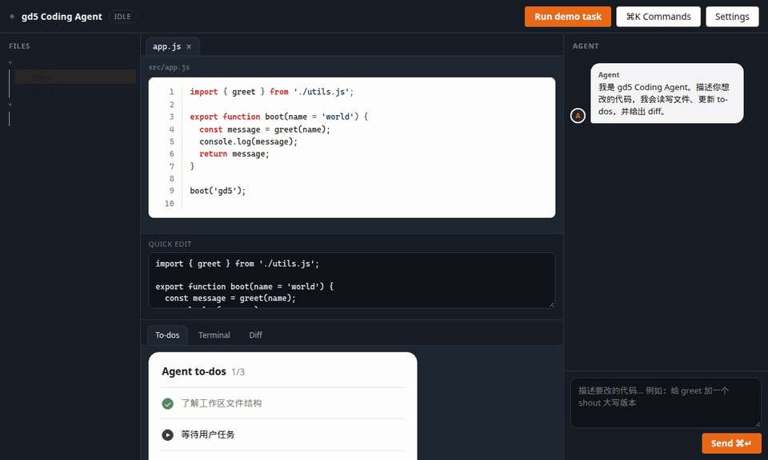

# gd5 Engine + UI

Minimal **real-DOM** runtime (no VDOM, no bundler) plus an **antd-style** UI kit — orange primary, white panels, themes `orange` / `blue` / `green`.

`src/product/` is a reference app only.

| Layer | Path | Docs |
|-------|------|------|
| Engine | `src/engine/` | [`docs/api.md`](docs/api.md) |
| UI kit | `src/ui/` | [`docs/ui.md`](docs/ui.md) · [gallery](examples/ui-gallery.html) |

[中文](README.zh_cn.md)

---

## Design goals

| Goal | Approach |
|------|----------|
| Small surface | `Component`, `ComponentRender`, `D` / `bind`, `LogProvider` |
| Real DOM | Mutate elements directly |
| Zero build | ESM `import` over HTTP |
| One lifecycle | Pages and children share `mount` / `unmount` |
| Hard to misuse | `ensureShell`, declarative `onClick`, co-located CSS |
| Ready-made chrome | `src/ui` Button / Input / Modal… |

---

## Install

No `dist/` required. Serve over HTTP (ES modules need a server):

```bash
python3 -m http.server 8080
```

```html
<script type="module">
  import { Component, ComponentRender, bind, LogProvider } from './src/engine/index.js';
</script>
```

---

## UI kit

```html
<link rel="stylesheet" href="./src/ui/css/ui.css">
<script type="module">
  import { Button, Card, Modal, setTheme } from './src/ui/index.js';
  setTheme('blue'); // or ConfigProvider({ theme: 'green' }, …)
</script>
```

```js
Button({ type: 'primary', text: 'Save', onClick: () => this.save() })
```

Catalog: [`docs/ui.md`](docs/ui.md). Live demo: [`examples/ui-gallery.html`](examples/ui-gallery.html).

| Orange (default) | Blue | Green |
|------------------|------|-------|
|  |  |  |

---

## Quick start

### 1. Page slots

```html
<div id="home"></div>
<div id="settings" style="display:none"></div>
<script type="module" src="./app.js"></script>
```

### 2. Component

```js
import { Component } from './src/engine/index.js';

export class HomePage extends Component {
  static styles = new URL('./HomePage.css', import.meta.url);

  async componentDidMount() {
    this.state.data.title = 'Hello';
  }

  render() {
    this.ensureShell((ids) => ids.root, ({ div, h1, button }) => {
      div(
        { id: 'root', className: 'home' },
        h1({ id: 'title', text: this.state.data.title }),
        button({
          id: 'btnNext',
          type: 'button',
          text: 'Settings',
          onClick: () => this.navigator.navigate('settings'),
        })
      );
    });
  }
}
```

### 3. Navigation

Pages get `this.navigator` / `this.logger` from `ComponentRender.init`. Children receive the same via `deps`.

```js
import { ComponentRender, LogProvider } from './src/engine/index.js';
import { HomePage } from './HomePage.js';
import { SettingsPage } from './SettingsPage.js';

const app = new ComponentRender({
  logProvider: new LogProvider({
    level: 'info',
    sink: 'console',
    context: { machId: 'local', userId: 'demo' },
  }),
});
app.init(
  { loading: 'home', home: 'home' },
  {
    home: HomePage,
    settings: { type: SettingsPage, isModal: true },
  }
);

window.addEventListener('DOMContentLoaded', () => app.render());
```

```js
this.toolbar = new ToolbarComponent({
  navigator: this.navigator,
  logger: this.logger,
  store: this.store,
});
this.navigator.navigate('preview', { doc });
```

---

## Core concepts

### Lifecycle

```
mount / navigate
  → adoptStyles → componentDidMount → render → componentDidAttachEvents

unmount / goBack
  → componentDidUnMount → engine clears on() listeners & host
```

### Checklist

1. `extends Component` — pages get `navigator` / `logger` from `init`
2. Co-locate CSS: `static styles = new URL('./X.css', import.meta.url)`
3. Build UI with `ensureShell` / `paint` + `bind`
4. Handlers in props: `onClick`, `onChange`, … (or `events`)
5. `this.on(window, …)` only for non-tree targets
6. Update with `setData` / `refresh` — do not re-`navigate` to refresh
7. Nest with `new Child({ navigator: this.navigator, logger: this.logger, … })`

### Composition

```js
div({ id: 'host-panel', className: 'component-host' });
await this.panel.mount('host-panel');
```

### Declarative DOM

```js
const { div, button, map } = bind();

div(
  { className: 'list', id: 'list' },
  ...map(
    items,
    (item, _i, key) =>
      button({ key, className: 'item', text: item.label, onClick: () => select(item) }),
    (item) => item.id
  )
);
```

### Styles

| Layer | Where |
|-------|--------|
| Tokens / shared | App-level CSS |
| Component-private | `FooComponent.css` next to `FooComponent.js` |

`mount` injects `static styles` once (auto-scoped to the host via `data-gd-c`; authors still write plain `.toolbar` / `className: 'toolbar'`). Unmount does not remove them.

---

## Layout & docs

```
src/engine/     runtime
src/ui/         component library
src/catalog/    site index (index.html) — products and example pages
src/product/    example apps (optional): ProtoLive, Coding Agent, Escape Room, Tidefront
examples/       gd5 apps (page slots + ComponentRender) — ui-gallery, demos
docs/           api.md · ui.md · engine.md · composition.md · architecture.md
plugins/        Cursor plugin `gd5-compose` (hierarchy + declarative assembly)
```

- [`docs/api.md`](docs/api.md) — engine API
- [`docs/ui.md`](docs/ui.md) — UI catalog & theming
- [`docs/engine.md`](docs/engine.md) — authoring guide
- [`docs/composition.md`](docs/composition.md) — hierarchy + declarative assembly (do / don't)
- [`docs/architecture.md`](docs/architecture.md) — boundaries
- [`skills/engine/README.md`](skills/engine/README.md) — short skill sheet (decompose first)
- [`plugins/gd5-compose/`](plugins/gd5-compose/) — Cursor plugin for agents (install under `~/.cursor/plugins/local/`)

---

## Example & tests

`http://localhost:8080/` is the **index** (`index.html` → `src/catalog/`), a gd5 app that lists products and example pages. Open a card to enter that page.

ProtoLive (`protolive.html` → `src/product/`) shows composition in a visual editor. **Coding Agent** (`agent.html` → `src/product/agent/`) is the fuller product demo: IDE chrome + UI kit embeds + store-driven agent turns. **Escape Room** (`escape.html` → `src/product/escape/`) is a 2D point-and-click escape demo (Midnight Archive). **Tidefront** (`archipelago.html` → `src/product/archipelago/`) is a 3D island-defense demo: ocean routes, cooldowns, and a front line that advances when you refresh. Safe to ignore when embedding the engine.



UI kit demos under `examples/` are **standard gd5 apps**: HTML page slots + `ComponentRender` / `LogProvider` (via `examples/demoApp.js`), same shape as `src/product/main.js`.

```bash
python3 -m http.server 8080
# Index:         http://localhost:8080/
# ProtoLive:     http://localhost:8080/protolive.html
# Coding Agent:  http://localhost:8080/agent.html
# Escape Room:   http://localhost:8080/escape.html
# Tidefront:     http://localhost:8080/archipelago.html
# gallery:       examples/ui-gallery.html
# demos:         examples/*-demo.html
node test/run.mjs
```

---

## License

MIT
